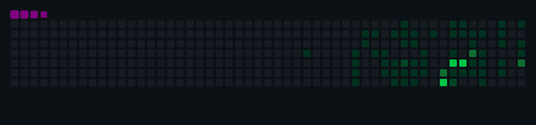

  <h1>Olá, eu sou o Vittor 👋</h1>

Estudante de **Análise e Desenvolvimento de Sistemas (FIAP)** com foco em backend com Python. Estou em busca de estágio em desenvolvimento de software, backend ou Python.

Depois de quase 10 anos como atleta profissional de Taekwondo, levo para o código a disciplina e a constância que o esporte me ensinou.

  

## Projetos

| Projeto | O que faz | Tecnologias |
|---|---|---|
| [LibraryManager](https://github.com/vittorguimaraes-git/academic-projects/tree/main/src/LibraryManager) | Sistema de biblioteca em linha de comando: livros, usuários, empréstimos e devoluções, organizado em camadas | Python, SQLite |
| [Expense Organizer](https://github.com/vittorguimaraes-git/academic-projects/tree/main/src/ExpenseOrganizer) | Controle de receitas e despesas, com relatório mensal e exportação para CSV | Python, JSON |
| [To-do List](https://github.com/vittorguimaraes-git/academic-projects/tree/main/src/todo_list) | Gerenciador de tarefas no terminal, com prioridade e data de vencimento | Python, JSON |
| [Estudos de Python](https://github.com/vittorguimaraes-git/cursoemvideo-python) | Exercícios e anotações do meu progresso no curso de Python | Python |

## Tecnologias

## Contato

E-mail: **vittorguimaraes.git@gmail.com**

English: Software development student (FIAP) focused on Python backend, looking for an internship.
